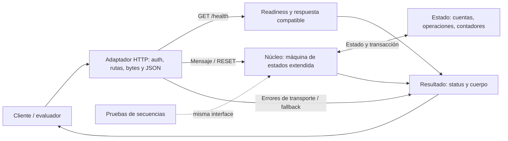
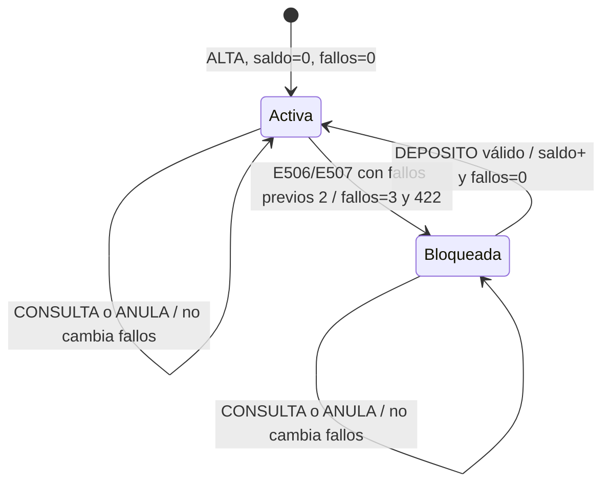
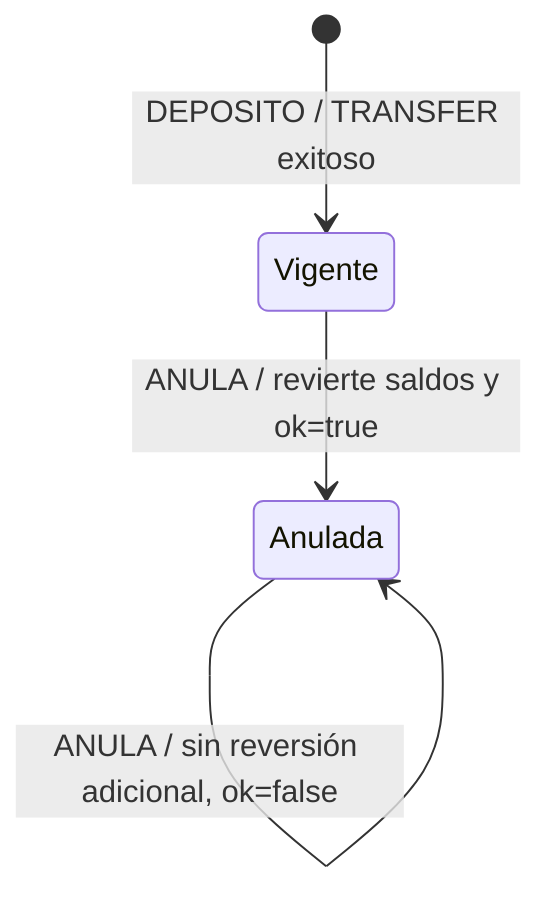

# Arquitectura · Máquina de estados extendida

**Entregable visual:** [HTML con arquitectura y estados](entregables/02-diagrama-arquitectura.html).

El diseño separa **adaptador de entrada**, **núcleo de dominio** y **estado**. Implementado: `reemplazo/src/server.js`, `reemplazo/src/domain.js` y Map en memoria, sin transacciones SQL. Propuesto: seam transaccional y SQLite sólo si se exige durabilidad. El núcleo concentra las reglas; transporte y persistencia no las redefinen.

## Módulos y flujo

La separación es hexagonal **mínima**: adaptador de entrada y seam de estado alrededor de un deep module. Parser, guardas y handlers son implementación privada; no hay módulos públicos por cada paso. La seam de persistencia propuesta es una ejecución transaccional, no repositorios genéricos por tabla. Migrar requiere adaptar el acceso a estado y validar driver/runtime. Las respuestas del núcleo regresan al adaptador HTTP y luego al cliente; health y errores de transporte responden desde el adaptador.

El núcleo modela `δ(S, evento) = (S′, respuesta)` y no depende de objetos HTTP. La representación formal no obliga a copiar todo `S` por request ni a introducir una librería de estados.

## Estado de una cuenta

El bloqueo es **derivado** de `fallos≥3`, no un flag duplicado. La guarda de `E510` se evalúa después de monto, igualdad y existencia de cuentas; un origen bloqueado todavía puede responder `E303/E304/E401`. Depósito y transferencia modifican también saldos e historial de operaciones; el diagrama sólo proyecta el estado de control de la cuenta.

## Estado de una operación

`ANULA` no limpia fallos de cuenta. `RESET` elimina las cuentas/operaciones de ambos diagramas y devuelve los contadores a 1. `PING`/`CONSULTA` no mutan el estado de negocio. Un HTTP 422 no implica ausencia de transición.

## Persistencia propuesta y operación

SQLite no está implementado. Actualmente, reiniciar pierde el estado; varias réplicas no comparten Map. Si se exige durabilidad:

- Tres tablas: **cuentas**, **operaciones** y **contadores**, en un volumen local persistente; un proceso y un escritor.
- Saldo, operación e ID se confirman juntos. `E506/E507` confirman su incremento de fallos aunque el resultado sea un error de negocio.
- Reset comparte la misma exclusión y transacción. Rollback por fallo interno, no por el status HTTP.
- No se impone saldo no-negativo ni se normalizan identificadores: se sigue el contrato observado.
- Sin ORM, cola, caché, event sourcing ni framework FSM. Una instancia; PostgreSQL sólo se plantea con réplicas reales.
- Sin cliente, URL ni credenciales del original en producción; sin proxy/fallback.

## Verificación

La interface es la superficie de pruebas: mensajes y reset, seguido de consultas que revelen efectos. Se verifican transiciones, guardas combinadas y secuencias reservadas de 2–5 y 6–12 pasos. Aceptación: 100% de pasos con status/cuerpo y efectos posteriores coincidentes, cero timeouts y cada paso <5 s en URL pública; una media o p95 no sustituye el límite individual. De 20:00 hasta fin de demo day: health autenticado cada 60 s, cero fallos observados. Ver casos T1–T6 en el documento de diseño.

El dígito de control MOD 97 no es una firma criptográfica. Se conserva el contrato, incluyendo typos y errores con cambios de estado; las incertidumbres se registran como supuestos, no como capacidades verificadas.

Fuentes: `frontier-reto-2/README.md`; `reto2-investigacion/experimentos.jsonl` (347 observaciones); `reto2-investigacion/data/pares_control.jsonl` (34 pares); `reto2-investigacion/SPEC.md`. Detalles y trade-offs: [01-diseno.md](01-diseno.md).
